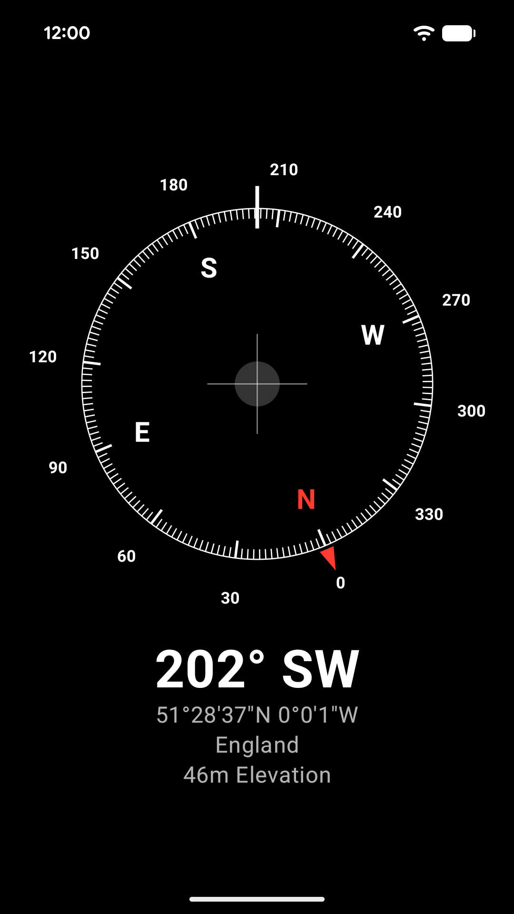
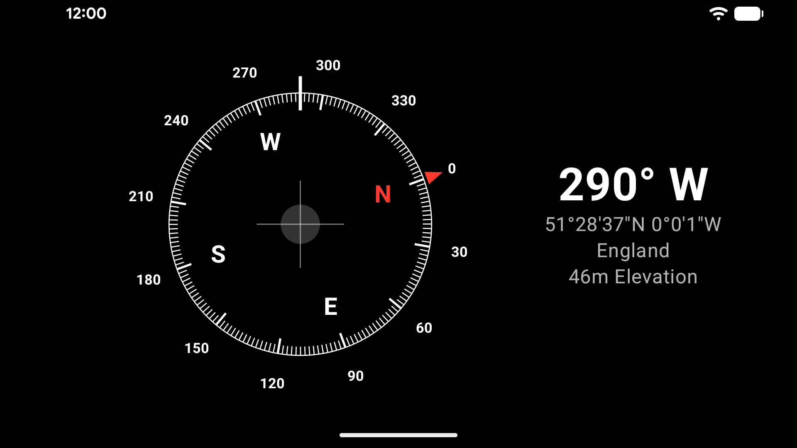

<!--
SPDX-FileCopyrightText: Saalim Quadri <danascape@gmail.com>
SPDX-License-Identifier: GPL-3.0-or-later
-->

# Compass


A clean, ad-free compass with your coordinates, elevation and a home screen widget. No ads, no
tracking, no internet permission.

<p align="center">
  
  
</p>

## Features

- Large heading readout with the direction (N, NE, E, …)
- Smooth rotating dial with a mark every 2° and a red north arrow
- A gentle haptic tick every 30°
- Your coordinates in degrees, minutes and seconds, the place you are in and your elevation
- Home screen widget: the dial with your last known location
- Portrait and landscape, with the heading corrected for how you hold the device
- Layouts for phones, tablets and foldables

Compass shows magnetic north. Keep the phone away from magnets and metal, and move it in a figure
eight if the heading seems off.

## Download

<a href="https://f-droid.org/packages/org.prauga.compass/"></a>
<a href="https://apps.obtainium.imranr.dev/redirect?r=obtainium://add/https://github.com/PVOT-OSS/PvotCompass"></a>
<a href="https://github.com/PVOT-OSS/PvotCompass/releases"></a>

Requires Android 11 or newer.

Compass comes in two builds:

| Build | Location | For |
|---|---|---|
| `gms` | Google Play services fused location; shows coordinates, place and elevation | phones with Google Play services |
| `fdroid` (`foss` flavor) | no location features; the compass alone | F-Droid and phones without Google services |

## Privacy

No accounts, no ads, no analytics and no internet permission. Location is used only if you allow
it, to show your coordinates, place and elevation; the compass works without it. See the
[Privacy Policy](PrivacyPolicy.md).

## Building

You need JDK 21 and the Android SDK (`ANDROID_HOME` set).

```sh
./gradlew assembleGmsDebug assembleFossDebug
```

The APKs are written to `app/build/outputs/apk/<flavor>/debug/`, with renamed copies under
`app/build/outputs/apk/renamed/`.

## Contributing

Bug reports and pull requests are welcome on
[GitHub](https://github.com/PVOT-OSS/PvotCompass/issues). When reporting a bug, include the steps
to reproduce it, the app version, the build (`gms` or `fdroid`) and your device and Android
version.

Sign off your commits (`git commit -s`, [DCO](https://developercertificate.org/)). Every file
carries an SPDX header; CI runs [REUSE](https://reuse.software/) checks on each pull request.

## License

Copyright (c) Saalim Quadri.

Licensed under the [GNU General Public License v3.0 or later](LICENSE). The Gradle wrapper is
under the [Apache License 2.0](LICENSES/Apache-2.0.txt).
